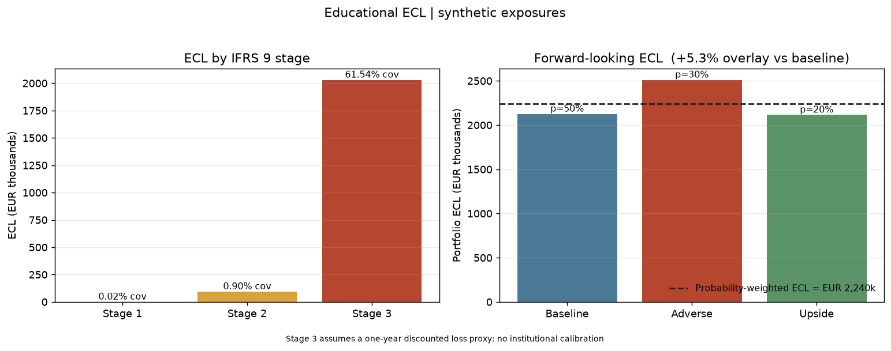

# Educational expected credit loss engine

Explore rating-based default curves, amortisation, staging and weighted scenarios on **synthetic corporate exposures**. This recovered archive is a teaching project, not a bank implementation or a claim of regulatory compliance.

See the [technical overview](docs/UNDERSTAND_THE_PROJECT.md) and [technical changes](docs/REVIEW.md).

## Run locally on Windows

From this directory:

```powershell
py -3.13 -m venv .venv
.\.venv\Scripts\python.exe -m pip install -r requirements.txt -r requirements-dev.txt
.\.venv\Scripts\python.exe -m pytest -q
.\.venv\Scripts\python.exe -X utf8 ecl_engine_phase1.py
.\.venv\Scripts\python.exe -X utf8 ecl_engine_phase2.py
.\.venv\Scripts\python.exe -X utf8 ecl_engine_phase3.py
.\.venv\Scripts\python.exe -X utf8 ecl_engine_phase4.py
.\.venv\Scripts\python.exe -X utf8 macro_pd.py
.\.venv\Scripts\python.exe scripts/export_verified_examples.py
.\.venv\Scripts\python.exe make_figures.py
.\.venv\Scripts\python.exe -m streamlit run app.py
```

Recovery checks used Python 3.14 with existing scientific libraries and isolated packages configured by `../../_workspace/tools/run_checks.py`; see the root environment record. The core engine demonstrations use only the standard library. Dashboard, figure and spreadsheet export dependencies are separate.

## Implementation

| Component | Scope |
|---|---|
| Stage 1 | One-year discounted PD × LGD × exposure; simplified loss timing |
| Lifetime ECL | Annual unconditional default increments × LGD × beginning-of-year exposure × discount factor |
| Schedules | Bullet and equal-instalment amortisation |
| Staging | Configurable rating/PD/qualitative triggers and days-past-due backstops |
| Stage 3 | **PD=1, one-year discounted LGD-loss proxy**; no fitted recovery cash flows |
| Scenarios | Rating shifts, LGD stress and weighted aggregation |
| Macro experiments | Standard Vasicek conditional PD and a **separate anchored-probit rating-shift bridge** |



## Data and evidence

- Borrowers and exposures are synthetic, with neutral IDs. Scenario weights, LGDs, policy thresholds and macro sensitivities are assumptions.
- Embedded published anchors are attributed in [sources.md](sources.md).
- [reports/verified_examples.json](reports/verified_examples.json) and its workbook companion contain current Python-computed values. The workbook is an export, not independent Excel validation.
- Original Phase1–4 workbooks and the presentation are sanitized **historical references**, unreconciled to the corrected Stage 3 measurement and macro terminology. Use the new export and guide for current calculations.
- [docs/verification.json](docs/verification.json) records checks actually executed. Successful execution does not establish regulatory compliance.

## Limits

Annual periods, proxy LGDs, hard-coded curves, simplified policy/staging and scenario-specific restaging. No institution-specific calibration, prepayment/revolving-credit behaviour or recovery-timing estimation. Beyond observed PD years, output flags extrapolation using the final conditional hazard.

The anchored-probit bridge is not equivalent to the standard Vasicek formula. Its hand-set coefficients produce representative rating notches, not a fitted PIT term structure directly integrated into ECL.

Required copyright notices and public research attribution remain. Original files are preserved in the project's ignored `.private/backups/` folder, which must not be published.
